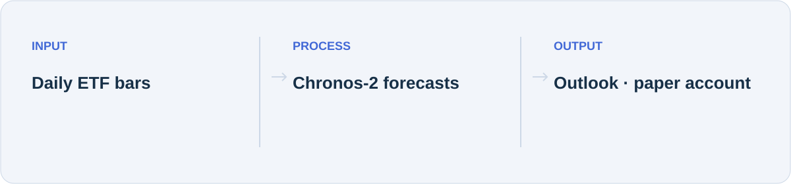

<!-- readme-header32:start -->

<h1 align="center" id="project-title">ETF Project</h1>

ETF forecasts and paper-account records

  
  

  
  
  
  
  

<small>LEVEL links open the Korean source at the same reading level.</small>

<picture>
  <source media="(max-width: 600px) and (prefers-color-scheme: dark)" srcset="../assets/readme/flow-en-dark-mobile.svg" />
  <source media="(max-width: 600px)" srcset="../assets/readme/flow-en-light-mobile.svg" />
  <source media="(prefers-color-scheme: dark)" srcset="../assets/readme/flow-en-dark.svg" />
  <source media="(prefers-color-scheme: light)" srcset="../assets/readme/flow-en-light.svg" />
  
</picture>
<!-- readme-header32:end -->

**Current status:** The active project remains revision 6. The latest Astryx dashboard from design revision 7 is integrated into revision 6/web and served directly at port 8879. The default launcher uses revision 6; port 8880 and the revision 7 proxy are historical design instructions. Running training and the server were not restarted for this UI replacement.

<!-- project-levels:start -->

## Choose a reading level

| Level | What this guide covers |
| --- | --- |
| [LEVEL 1 - Beginner (Korean source)](../docs/읽기안내/레벨1.md) | Plain explanations of unfamiliar terms, actual behavior, examples, and boundaries that can be misunderstood. |
| [LEVEL 2 - Explorer (Korean source)](../docs/읽기안내/레벨2.md) | Connections between inputs, processing, outputs, and features, and changes across revisions. |
| [LEVEL 3 - Practitioner (Korean source)](../docs/읽기안내/레벨3.md) | Prerequisites, usage steps, settings, results, and how to identify failures. |
| [LEVEL 4 - Advanced (Korean source)](../docs/읽기안내/레벨4.md) | Module design, state transitions, validation boundaries, and implementation choices. |
| [LEVEL 5 - Expert (Korean source)](../docs/읽기안내/레벨5.md) | Actual code, protocols, configuration values, full comparisons, and measurement evidence. |

Every guide covers the same project and all revisions. The existing detailed text remains below.
<!-- project-levels:end -->

## Revision 7 design history: Astryx dashboard and Rust-generated themes

The original palette, NanumGothic 700, controls, and data logic are preserved. The screen uses official Astryx neutral CSS, two themes generated by the Rust tool at build time, and a selector adapter. Existing independent evidence covers 44px controls, both themes, 390/1440px layouts, hover, and real Tab focus. These UI checks do not demonstrate forecasting accuracy, investment returns, or GPU acceleration.

| Boundary | Revision 7 behavior |
| --- | --- |
| Screen | Separate local server at 8880; generated CSS is included |
| Data and controls | Relay the existing 8879 API; no new account or worker |
| Current connection | HTTP 503 while upstream is unavailable; no automatic engine restart |
| Rebuilding themes | Included Rust Cargo source; the original E shared-engine and npm 0.7.17 dependencies are documented in the Korean reproduction guide |

[Revision 7 details (Korean source)](../7차/docs/차수설명.md) · [Usage and reproduction (Korean source)](../7차/사용%20안내.md) · [All revisions](../7차/docs/REVISION_INDEX.md) · [Full comparison](../7차/docs/7차%20전체%20비교.md)

## Revision 6: separating operational forecasting

The behavior was changed so that **the last accepted saved model forecasts the latest completed daily bars**, even when additional training is rejected or no new training date is available. Revision 5's weight protection, training budget, and fixed validation remain in place.

| Process | Revision 5 behavior | Revision 6 behavior |
| --- | --- | --- |
| Additional training rejected | Also skip publishing a new forecast | Run operational forecasting with the accepted saved model before training |
| No new training date | Continue only collection and existing-order processing | Forecast with the accepted saved model when the forecast input is new |
| Rechecking the same input | Do not schedule a new training round | Skip reloading the model when the saved-model, context, and data hashes match |
| First collection in continuous operation | May skip collection when PC uptime is shorter than the collection interval | Collect on the first loop, then apply the 6-hour interval |
| Stop or damaged saved model | Protect weights | Check STOP and SHA-256 on the forecasting path as well |

[Full revision index (Korean source)](../6차/docs/REVISION_INDEX.md) · [Revision 6 details (Korean source)](../6차/docs/6차%20상세.md) · [Full comparison (Korean source)](../6차/docs/6차%20전체%20비교.md)

## Preparation record from revision 5

[Full revision index including revision 5 (Korean source)](../5차/docs/REVISION_INDEX.md) · [Revision 5 details (Korean source)](../5차/docs/5차%20상세.md)

Revision 5 implemented limited training per new observation and validation before saving. Switching the running system to revision 5 was not completed, and GPU-based additional training, independent future performance, and complete prevention of overfitting were not demonstrated. The revision 4 documents and records below are retained as the previous state.

| Condition | Revision 5 protection design |
| --- | --- |
| Training timing | Once initially, then when a new eligible observation date becomes available |
| Preventing repetition | Persist the reservation before training to prevent repeatedly scheduling or restarting a new round using only the same observation set |
| Training settings | Maximum 25 steps, learning rate 0.000001, weight decay 0.01, gradient clipping 1.0 |
| Checks before saving | Allow zero deterioration in before/after MAE and MAPE on fixed validation data for the first three ETFs; check finite values and sample counts |
| Deterioration, STOP, or error before publication | Keep the existing operational pointer; prohibit publishing order forecasts from the new weights |
| No new observation | Wait for training; continue data collection and paper operation |

A new date is a condition permitting a new round. An allowed round reuses the entire permitted training dataset, so historical rows can also be sampled again. Sampling is random; there is no guarantee that every new row is trained on in every round.

STOP is checked immediately before publication, but complete atomicity across processes between a separate STOP file and the pointer is not guaranteed. If reporting or ledger recording fails after validation and atomic pointer publication have finished, the already published validated weights remain in place. Atomic saving of the reservation file alone does not prevent concurrent contention; a single-worker lock is the operational boundary.

This design **protects additional training of the same Chronos-2 model**; it does not select a winner by competing different models.

Repeatedly checking fixed validation data leaves a risk of adapting to that validation dataset.

The three-ETF criterion does not demonstrate independent performance across all 15 ETFs and the exchange rate.

Forward evaluation remains separate.

Neither complete prevention of overfitting, automatic repair of an already overfitted model, nor investment returns are guaranteed.

## Existing public guide

The revision 4–5 descriptions below record their state when they were written. Follow the revision 6 guide above for current operation.

## Earlier revision 4 project record

This is a local training and paper-operation tool for a long-term investment plan of at least 10 years. It continually trains the latest weights of one pretrained time-series model, Chronos-2, and automatically selects and trades ETFs in a virtual account that converts KRW 1,000,000 into US dollars. Actual holdings and a Toss account are not connected.

**Technical areas:** time-series forecasting · additional training · long-term paper investing · local dashboard

[Data and fill boundaries (Korean source)](../3차/docs/자료와%20모의체결%20범위.md) · [All revisions (Korean source)](../4차/docs/REVISION_INDEX.md) · [Change log (Korean source)](../4차/변경기록.md)

## Running the tool

The revision 5 preparation build was configured to use the dedicated revision 1 environment and private storage. Switching operation to revision 5 was not completed. Public code does not include model weights or the runtime environment.

- If the server is running, open the [dashboard](http://127.0.0.1:8879/).
- If the server is stopped, run `대시보드 실행.cmd` in the project's final-delivery folder.
- See the [user guide (Korean source)](../4차/사용%20안내.md) for stop/resume behavior and the scope of cost reproduction.

## All revisions

| Revision | Main change | Materials |
| --- | --- | --- |
| 1 | Initial training and evaluation | [Folder (Korean source)](../1차) · [Details (Korean source)](../1차/docs/1차%20상세.md) · [Initially added files (Korean source)](../1차/docs/1차%20전체%20비교.md) |
| 2 | Numeric display and controls | [Folder (Korean source)](../2차) · [Details (Korean source)](../2차/docs/2차%20상세.md) · [Comparison with previous revision (Korean source)](../2차/docs/2차%20전체%20비교.md) |
| 3 | Holdings and automated trading | [Folder (Korean source)](../3차) · [Details (Korean source)](../3차/docs/3차%20상세.md) · [Comparison with previous revision (Korean source)](../3차/docs/3차%20전체%20비교.md) |
| 4 | Training on all available history | [Folder (Korean source)](../4차) · [Details (Korean source)](../4차/docs/4차%20상세.md) · [Comparison with previous revision (Korean source)](../4차/docs/4차%20전체%20비교.md) |
| 5 | Training protection per new observation | [Folder (Korean source)](../5차) · [Details (Korean source)](../5차/docs/5차%20상세.md) · [Comparison with previous revision (Korean source)](../5차/docs/5차%20전체%20비교.md) |
| 6 | Separating operational forecasting and training | [Folder (Korean source)](../6차) · [Details (Korean source)](../6차/docs/6차%20상세.md) · [Comparison with previous revision (Korean source)](../6차/docs/6차%20전체%20비교.md) |
| 7 | Astryx dashboard and Rust-generated themes | [Folder (Korean source)](../7차) · [Details (Korean source)](../7차/docs/차수설명.md) · [Comparison with previous revision (Korean source)](../7차/docs/7차%20전체%20비교.md) |
| Final | Runtime and guidance | [Folder (Korean source)](../최종) · [User guide (Korean source)](../최종/사용%20안내.md) · [Contents (Korean source)](../3차/docs/최종%20구성.md) |

Existing revisions are preserved. The final-delivery folder contains only the currently verified launch files and user guide, without mixing in code, historical files, or operational materials. Revisions are software change bundles; they do not represent independent test counts or investment performance.

## Holdings and trading

The screen shows current ETF holdings, quantities, average purchase prices, KRW acquisition costs and valuations, and unrealized gains or losses. Pending orders and fills are separate. Buy/sell filters and pagination provide access to the entire fill history. Currency conversion has its own records. There may be zero trades before a new observation is obtained.

The candidates are QQQM, SCHG, SPYM, VTI, VEA, VWO, BND, IEF, TLT, SGOV, GLD, XLK, XLF, XLV, and XLE. Selection is automatic under model forecasts, cost constraints, and available cash. This is not a validated list of every ETF or every instrument supported by Toss. Borrowing, short selling, and leveraged ETFs are not used.

Completed daily bars for training are distinct from completed regular-session one-minute bars used for fills. A paper fill requires a bar that began after the order, belongs to the current regular session, and meets the maximum 20-minute delay condition. Historical, after-hours, future, and stale observations are not converted into fills. Missing free data is shown as waiting. One-second screen-status updates do not mean second-by-second real-time market prices.

## Continued training and interpreting performance

The same latest weights of `amazon/chronos-2` are continually updated.

Models are not competed or selected anew for each round.

The original and adjusted fixed-evaluation values for the first three ETFs are preserved first. Revision 4 requests all obtainable daily bars for 15 ETFs and KRW=X, and trains dates on or before 2024-06-03 and after 2026-11-06 as separate time series.

Validation dates 2024-06-04–2025-08-21 and test dates 2025-08-22–2026-11-06 are excluded from training for every asset.

The exchange rate is an independent univariate series, not an ETF covariate or causal-learning input.

Additional training after the test period is not independent test performance.

The actual available history and training eligibility of short segments must be checked from execution results.

Training for about two months is an operational plan. Repetition occurs while the PC and local process are running and is affected by power, sleep, internet connectivity, and process interruption. Repeated sampling counts are distinct from the number of independent original observations.

In the initial 20-step test, the raw MAPE was about 0.7643% for additional training and about 0.7550% for a no-change forecast; both round to 0.8% in the summary. This did not demonstrate superior investment returns.

Historical paper comparisons, forward records accumulated during operation, and assumed-return scenarios are different. The asset-specific and time-specific boundaries of pretraining data have not been established. Ten years is the planned duration; a short ETF history is not presented as 10 years of measured performance. Returns, preservation of principal, and real-trading performance are not guaranteed.

## Numbers and raw values

Percentage summaries round to one decimal place; the stored raw ratios and full precision can be expanded for inspection. A rounded 100.0% is distinct from every answer actually being correct. Raw-value snapshots are refreshed explicitly, and original results are not changed for display purposes. Earlier display methods from revisions 1 and 2 remain in the historical documents.

## Costs and publication boundaries

The tool incorporates Toss's base trading fee of 0.1% and the public default assumptions for currency-conversion and SEC costs. These are not identical to all actual tradable instruments, quotes, settlement, dividend-payment dates, exchange rates, or taxes. Actual Toss orders are not sent. Raw market data, weights, paper ledgers, credentials, personal instructions, and operational records are excluded from publication.

This software project has no paper or manuscript. Unit, display, and API-boundary checks and a separate review are performed. Publication is checked through the current remote commit, complete tree, key raw HTTP files, and revision links. Historical failures and unverified UI areas remain in separate local records.

## Current revision 6 dashboard integration

Revision 6 contains the approved web assets, theme generator, palette, licenses, and Rust source. Runtime no longer needs the revision 7 directory. Engine code, private data, models, and configuration are preserved. Existing UI and Rust checks are reused; integration checks cover served asset bytes, the default launcher, and the active worker. No speed, forecasting, or return improvement is claimed.

[Current usage (Korean source)](../6차/사용%20안내.md) · [Integration comparison](../6차/docs/화면%20통합%20비교.md)
